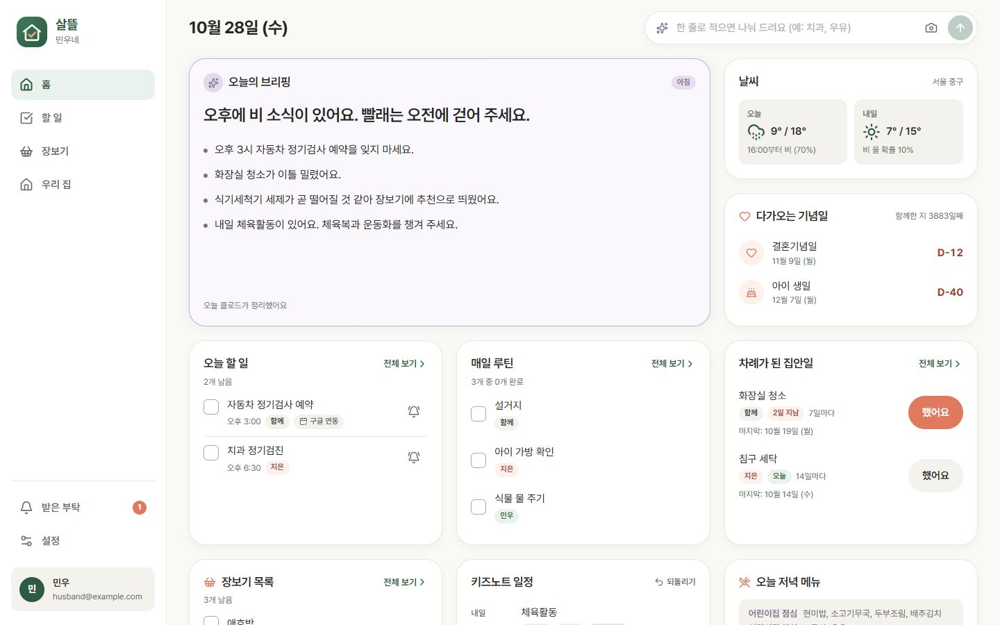

# 살뜰

부부가 함께 쓰는 살림 앱입니다. 할 일, 장보기, 매일 루틴, 주기 집안일, 기념일, 소모품 교체 주기를 한곳에서 보고, 한 사람이 고치면 다른 사람 화면에도 바로 바뀝니다. 클로드가 아침저녁 브리핑을 쓰고, 어린이집 알림장(키즈노트)에서 일정과 준비물을 뽑아 할 일에 넣습니다.

안드로이드는 앱과 홈 화면 위젯으로, 아이폰은 사파리 「홈 화면에 추가」 웹앱으로 씁니다.



## 기능

1. 할 일: 담당(나·배우자·함께) 표시, 구글 캘린더 한 개와 양방향 동기화
2. 장보기: 수량·메모, 소모품 소진 예측으로 살 것 추천
3. 매일 루틴과 주기 집안일: 하루는 오전 4시에 바뀜, 집안일은 마지막으로 한 날부터 다음 차례를 셈
4. 기념일과 D-day, 날씨(기상청 단기예보)
5. 클로드 브리핑: 매일 07:30·20:00, 일요일 저녁 주간 미리보기
6. 빠른 입력: 「내일 3시 소아과, 우유 2개」처럼 한 줄로 적거나 말하면 할 일·장보기로 나눠 제안. 가정통신문 사진·PDF도 읽음
7. 키즈노트: 알림장과 공지사항에서 일정·준비물·마감을 뽑아 넣고, 한 번에 되돌릴 수 있음. 주마다 알림장으로 성장 기록을 씀
8. 저녁 메뉴: 어린이집 월간 식단표 사진을 올려 두면, 평일 오후에 앞뒤 며칠 식단과 겹치지 않는 저녁 메뉴 세 가지를 추천
9. 배우자에게 부탁 알림 보내기

## 구성

| 부분 | 기술 |
|---|---|
| 화면 | React, TypeScript, Vite, Tailwind CSS |
| 안드로이드 앱 | Capacitor, 위젯은 Java RemoteViews |
| 로그인·데이터 | Firebase Authentication(구글), Cloud Firestore |
| 서버 작업 | Cloud Functions(서울 지역), 15분마다 도는 작업 하나 |
| 클로드 | Claude Sonnet 5.5(브리핑·추출), Claude Haiku 5.5(빠른 입력·저녁 메뉴) |
| 음성 입력 | Google Cloud Speech-to-Text v1(한국어) |
| 웹 호스팅 | Vercel |

폴더:

- `src/`: 화면
- `shared/`: 화면과 서버가 함께 쓰는 날짜 계산·규칙
- `functions/`: 서버 함수
- `android/`: 안드로이드 앱과 위젯
- `copy/`: 화면 문구(`copy-spec.json`이 명세, `ko.json`이 결과)

## 직접 설치하기

이 저장소는 한 가족이 쓰도록 만든 앱이라, 가족 수와 계정 수는 두 명으로 고정돼 있습니다. 처음 설치하는 순서는 [설치 안내](docs/설치-안내.md)에 자세히 있습니다(Firebase 설정, 서버 함수 값, 캘린더 공유, APK 서명과 자동 빌드, 휴대폰 설치). 아래는 줄인 판입니다.

1. Firebase 프로젝트를 만들고 Authentication(구글), Firestore, Functions를 켭니다. 서버 함수는 사용량 요금제(Blaze)가 필요합니다.
2. `.firebaserc`의 프로젝트 이름을 바꾸고, 웹 설정값을 `.env.production`에 넣습니다(`VITE_FIREBASE_API_KEY` 등 7개, `src/firebase.ts`와 `src/pwa/push.ts` 참고).
3. 서버 함수 설정값을 넣습니다.
   - 일반 값: `HUSBAND_EMAIL`, `WIFE_EMAIL`(앱에 들어올 수 있는 두 계정)
   - 비밀값: `ANTHROPIC_API_KEY`, `KMA_SERVICE_KEY`(공공데이터포털 기상청 단기예보)
4. 구글 클라우드에서 Speech-to-Text API와 Google Calendar API를 켭니다.
5. 배포합니다.

   ```
   npm ci
   npm run build:web
   npx firebase deploy --only functions,firestore
   ```

시험 서버로 먼저 돌려 볼 수 있습니다. `npx firebase emulators:start --project demo-saltteul` 뒤에 `node scripts/seed.mjs`, `npm run dev`를 실행하고 husband@example.com 또는 wife@example.com으로 들어갑니다.

## 업데이트 방식

- 화면만 바뀐 경우: 웹에 배포하면 끝납니다. 안드로이드 앱은 켜질 때 `app-update/latest.json`을 읽어 새 화면 묶음을 받고, 다음에 앱을 다시 열 때 적용합니다(`src/pwa/liveUpdate.ts`, Capgo 업데이터를 자체 호스팅으로 사용). 아이폰 웹앱은 원래 웹을 따라 바뀝니다.
- 안드로이드 본체가 바뀐 경우(위젯, 권한, 플러그인): `v0.3.1` 같은 태그를 올리면 GitHub Actions가 서명된 APK를 만들어 Releases에 붙입니다(`.github/workflows/android-release.yml`). 휴대폰의 [Obtainium](https://github.com/ImranR98/Obtainium)에 이 저장소를 등록해 두면 새 버전을 알려 줍니다. 이때 화면 묶음이 새 본체를 요구하면 `scripts/update-config.json`의 `minNative`를 올립니다.

이 저장소를 가져다 쓰려면 `src/pwa/liveUpdate.ts`의 `UPDATE_MANIFEST_URL`을 자기 웹 주소로 바꿔야 합니다.

## 알아 둘 점

- 키즈노트는 공개 API가 없어서 키즈노트 웹이 쓰는 비공식 주소로 읽습니다. 키즈노트가 주소나 로그인 방식을 바꾸면 이 기능만 멈추고, 이용약관에 맞는지는 확인하지 않았습니다. 비밀번호는 저장하지 않고 로그인 세션만 서버 전용 문서에 둡니다.
- 비밀값(클로드 API 키, 서명 키, 기상청 키)은 저장소에 없습니다. Firebase 비밀 저장소와 GitHub Actions 비밀값으로 넣습니다.

## 라이선스

MIT. [LICENSE](LICENSE)를 봅니다.
